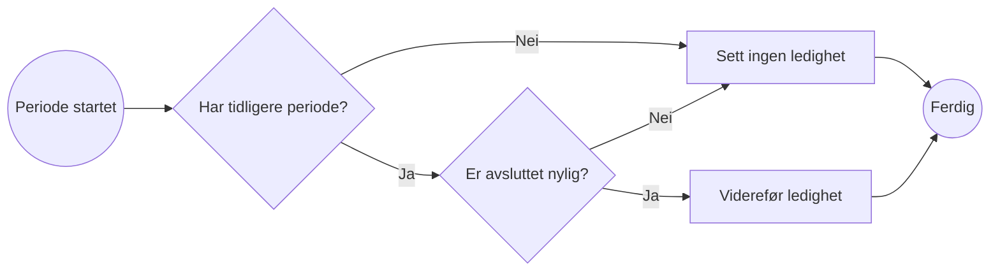
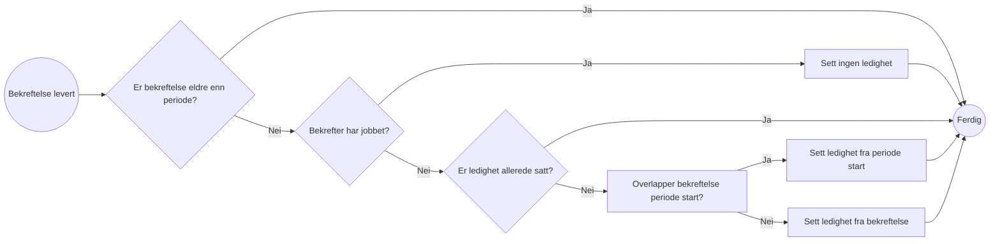
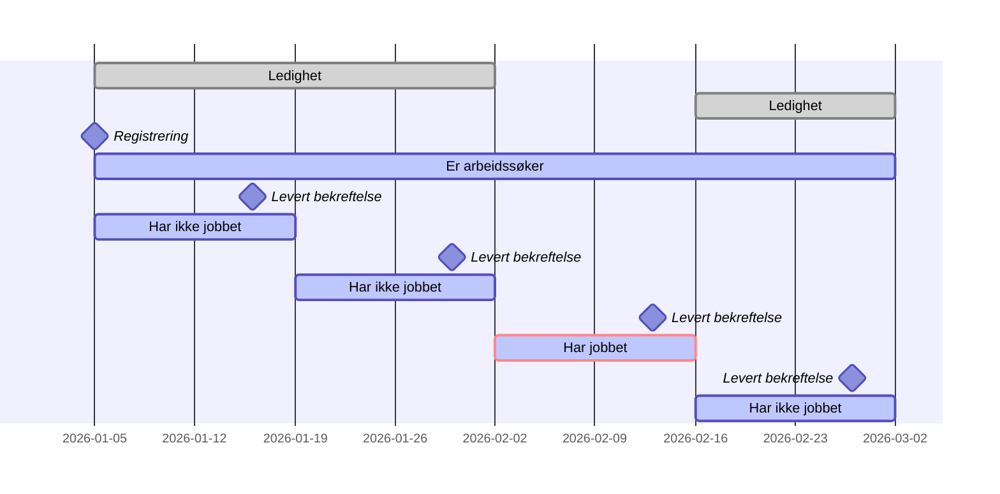
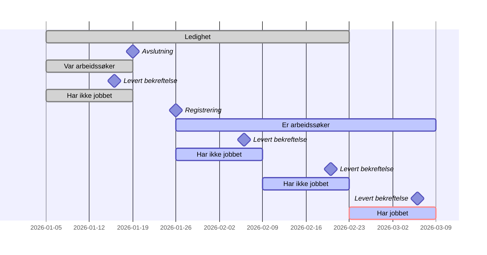
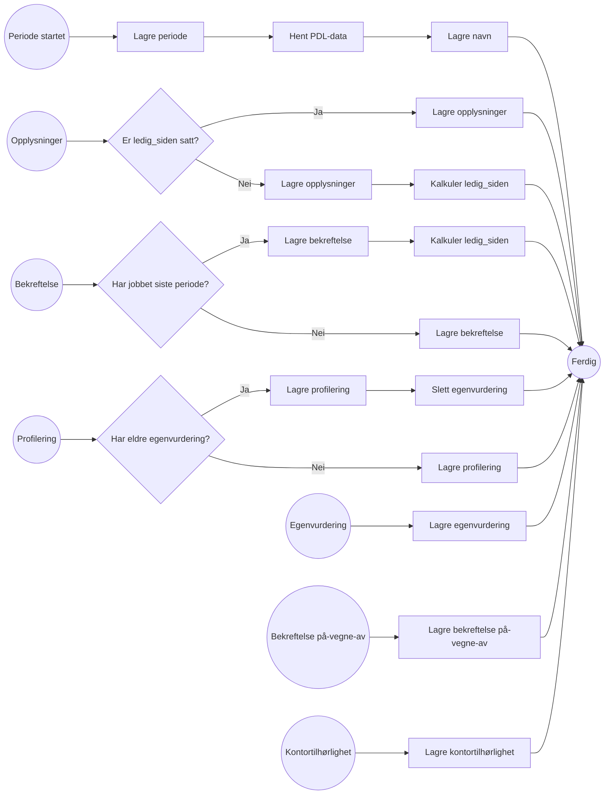

# Kartlegging API

API som kunne kartlegge porteføljen til saksbehandlere for sitt kontor. Det er en aggregering av data på tvers av
Arbeidssøkerregisteret med fokus på arbeidssøkeres ledighet og andre viktige datapunkter. Skal kunne filtrere på
ledighet og egenvurdering nyere enn en gitt dato.

## Utleding av ledighet

* Ikke aktiv arbeidssøker
    * Registrerer seg som arbeidssøker
        * Var tidligere registrert som arbeidssøker
            * Det er mindre en 14 dager siden avslutning
                * Tidligere ledighet er satt -> Viderefør tidligere ledighet
            * Det er over 14 dager siden avslutning -> Ikke sett ledighet (venter på bekreftelse)
* Aktiv arbeidssøker
    * Leverer bekreftelse
        * Bekreftelse er eldre enn periode -> ignorer
        * Bekreftelse er ikke eldre enn periode
            * Har jobbet -> Resett ledighet
            * Har ikke jobbet
                * Ledighet ikke satt
                    * Bekreftelse overlapper periode start -> Sett ledighet til start av periode
                    * Bekreftelse overlapper ikke periode start -> Sett ledighet til start av bekreftelse

OBS! Bekreftelser fra `Dagpenger` og `Friskmeldt til arbeidsformidling` kan ha start (og stopp) fra før perioden ble startet.

### Flytdiagram

#### Arbeidssøker registrerer seg

#### Arbeidssøker leverer bekreftelse

### Tidslinjer

#### Ikke tidligere vært arbeidssøker

#### Har tidligere vært arbeidssøker siste 14 dager

## Dataelementer

* Identitet
    * Fra periode start
    * Vedlikehold ved hjelp av identitet-topic
* ArbeidssøkerId
    * Hentet fra Kafka Key Gen ved periode start
* Navn
    * Hent fra PDL ved periode start
* Periode
* Kontortilhørlighet
    * Liste
    * ~~ [DAB datamodell](https://ao-oppfolgingskontor.intern.dev.nav.no/sdl) ~~
    * [DAB oppfolgingsperiode](https://navikt.github.io/veilarboppfolging/veilarboppfolgingV1/#operation-send-siste-oppfolgingsperiode-v3)
* Ledighet
    * Ledig siden dato
        * nulles ved "har jobbet"
        * gjelder fra for første bekreftelser
        * om har svart "har ikke jobbet" med gap på mer enn 14 dager, sett med fra dato etter gap
    * Siste gjelder til
* Bekreftelse
    * Fra dato
    * Til dato
* Profilering -> Slette tidligere egenvurdering om egenvurdering.profilering_id != ny profilering_id?
    * Siste
* Egenvurdering
    * Siste
* På-vegne-av -> Ny på-vegne-av-start så legges kilde til i listen (om den ikke finnes fra før). Tom liste =
  Arbeidssøkerregisteret har ansvaret selv.
    * Liste

### Hendelser

Logikk for mottak av hendelser.

## Spørringer

* Ledighet nyere/eldre enn
* Egenvurdert nyere enn

## Sikkerhet

* Azure saksbehandler token med ident
* Tilgangsstyring
* Auditlogging? nei, trenger ikke auditlogge for listevisninger

## Testdata

| identitetsnummer | navn                     | ledig_siden | tilknyttet_kontor                                   |
|------------------|--------------------------|-------------|-----------------------------------------------------|
| 24849098329      | SUNN VESTIBYLE           | 2026-04-30  | 4154:ARBEIDSOPPFOLGING, 0617:GEOGRAFISK_TILKNYTNING |
| 16488315440      | SLAKK KAKAOBØNNE         | 2026-06-03  | 0617:ARBEIDSOPPFOLGING, 0617:GEOGRAFISK_TILKNYTNING |
| 09448718961      | GJENNOMSIKTIG RØDFOTSULE | 2026-06-04  | 0617:GEOGRAFISK_TILKNYTNING                         |
| 24488623539      | EKSPLOSIV SKORPION       |             | 3030:GEOGRAFISK_TILKNYTNING                         |
| 02838698800      | TANKEFULL KLISJÉ         |             | 0118:GEOGRAFISK_TILKNYTNING                         |
| 28888896696      | SAKTE NORDAVIND          |             | 0604:GEOGRAFISK_TILKNYTNING                         |

## Poison Pills i dev

* `paw.arbeidssokerperioder-v1`
    * Partition 0
        * hwm 1730
            * fnr: 13497632174, aktor-id: 2078784314389, arbeidssøker-id: 139451 er splittet og ligger med feil state i
              Arbeidssøkerregister
    * Partition 1
        * hwm 438, 452
            * fnr: 02447919705, arbeidssøker-id: 133777 finnes ikke i lengre PDL
